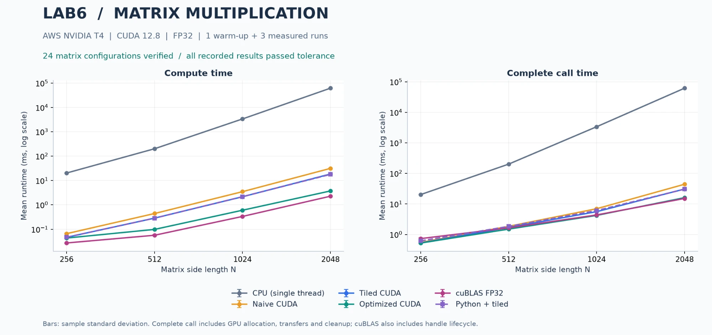

# Member C: Parts 5, 6.1, 7, and 8.3

Compilation, native and Python correctness checks, all formal measurements, and the image-processing application were completed on AWS T4 with CUDA 12.8 on October 13, 2026. All 105 configurations and 315 measured calls passed. Full timing values, errors, and provenance are recorded in C's measurement tables and run directory on the shared server (see the last section). All 18 CPU-only unit tests also passed locally and on the server.

> **Source version note (added when merging):** this batch used member B's kernels at commit `961a884`, before B's final tile-size selection (`4b472d5`) and convolution kernel choice (`93e9f2d`). The optimized kernel's tile configuration therefore differs from the current code at N=256 and N=1024 (N=512 and N=2048 are unchanged), so the optimized values and Q4 ratios at those two sizes differ from [report/B.md](B.md). The CUDA convolution timings here used the shared-memory kernel for K=3/5/7, where the current code uses the direct kernel.

## Part 6.1: Matrix Multiplication with cuBLAS

The implementation uses `cublasSgemm` for single-precision matrix multiplication. The project stores matrices in row-major order, whereas cuBLAS GEMM interprets memory in column-major order. Using `(AB)^T = B^T A^T`, the implementation passes `d_B` followed by `d_A`, both with `CUBLAS_OP_N`. The output memory can then be interpreted directly as row-major `C=A×B`. Self-tests use nonsymmetric matrices to detect operand-order or transpose mistakes.

The implementation selects `CUBLAS_PEDANTIC_MATH` to preserve FP32 arithmetic and does not enable TF32 or fast-math. Each call creates its own handle and uses the common helpers for argument validation, allocation, copies, event timing, synchronization, and cleanup. Handle creation occurs outside the compute event interval, and host-side end-to-end timing ends after handle destruction. Error paths release allocated resources, and nonzero return codes are treated as failures.

References: [NVIDIA cuBLAS 12.8 GEMM documentation](https://docs.nvidia.com/cuda/archive/12.8.1/cublas/index.html#cublas-t-gemm), [math modes](https://docs.nvidia.com/cuda/archive/12.8.1/cublas/index.html#cublasmath-t), and [handle creation](https://docs.nvidia.com/cuda/archive/12.8.1/cublas/index.html#cublascreate).

## Part 5: Performance Comparison and Figures

CPU, naive CUDA, tiled CUDA, further-optimized CUDA, and cuBLAS were measured on the same machine at N=256/512/1024/2048. Python calling the tiled implementation was included to examine the language interface. Each configuration received one warm-up call and three measured calls. Results report the arithmetic mean and sample standard deviation, using all three measurements.

Separate plots show `compute` and `end_to_end` runtime. Speedup is defined as `CPU mean / implementation mean` for the same input, host, and timing scope. The summarizer checks that all three runs are present, correct, and finite. Missing measurements are not replaced with zero, and failed configurations are excluded. The earlier local preview based on member A's data only validated the aggregation workflow; it is separate from C's formal measurements.

### Q4: How Close Is the Hand-Optimized Implementation to cuBLAS?

The ratio `optimized_mean_ms / cublas_mean_ms` compares the two implementations within the same timing scope. A ratio above 1 means cuBLAS is faster. For N=256/512/1024/2048, the compute ratios are **1.593 / 1.739 / 1.799 / 1.644**, respectively. cuBLAS has the shorter device-compute time at every tested size. At N=2048, optimized CUDA takes 3.737 ms and cuBLAS takes 2.273 ms.

The end-to-end ratios are **0.715 / 0.911 / 0.964 / 1.063**, respectively. Optimized CUDA has the shorter complete-call time at the first three sizes. At N=2048, cuBLAS takes 15.132 ms and optimized CUDA takes 16.081 ms. Kernel rankings therefore do not fully describe application call costs. All three measurements are retained, and sample standard deviations are available in `summary.csv`; no statistical significance test was performed.

### Q5: Why Can cuBLAS Be Faster?

cuBLAS selects optimized GEMM implementations for the matrix dimensions and hardware. Shared-memory reuse, register blocking, coalesced memory access, instruction scheduling, and occupancy can help explain performance differences. Identifying the actual limiting factor, however, requires measurements or profiler evidence. The use of cuBLAS alone does not guarantee the lowest runtime under every timing scope.

This experiment uses FP32 without enabling a reduced-precision Tensor Core mode, so the speedup cannot be attributed to TF32. Creating and destroying a handle on every call adds to cuBLAS end-to-end cost. At N=256, compute takes only 0.027 ms, while the complete call takes 0.735 ms. At N=2048, these times are 2.273 ms and 15.132 ms. Their difference includes allocation, transfers, synchronization, cleanup, and the handle lifecycle; it is not a separate measurement of transfer or handle overhead. NVIDIA recommends reducing repeated handle creation and destruction. A persistent handle is a possible future optimization, with its timing boundaries documented separately.

Member B's optimization uses shared memory and register subtiles, including a transposed A tile and `float4` accesses when alignment conditions are satisfied. At N=2048, it reduces compute time from the tiled implementation's 18.499 ms to 3.737 ms. cuBLAS reduces it further to 2.273 ms. No profiler evidence was collected to isolate the hardware bottleneck responsible for the remaining gap.

### Scaling and Overhead

For N=512→1024→2048, naive CUDA compute time increases from 0.442→3.491→31.532 ms, consistent with the trend of cubic arithmetic work. The CPU baseline is a single-threaded triple-loop implementation, whose scaling is also affected by cache and memory behavior. The observed speedups of several thousand times should not be generalized to a comparison against an optimized CPU BLAS library.

For convolution, each image was tested at M=512/1024/2048 and K=3/5/7. CPU cost increases with both image area and filter area. Allocation and transfer overhead make up a substantial part of CUDA complete-call time, so reductions in kernel time do not translate proportionally into end-to-end speedup. For the geometry image at M=2048 and K=7, CPU takes 388.189 ms, CUDA takes 8.939 ms, and Python CUDA takes 9.280 ms. Python CUDA achieves an end-to-end speedup of 41.83× over this CPU baseline.

## Parts 7 and 8.3: Shared Library and Python Integration

The Python wrapper uses `build/liblab6_cuda.so` and the existing `gpu_matrix_multiply` and `gpu_convolve` exports. It declares ctypes argument types and `restype=c_int`, and validates NumPy dtype, shape, contiguity, alignment, and the absence of input/output overlap. A nonzero status raises an exception; missing member B implementations produce an explicit error.

Ordinary calls use the two required exports. Timed calls use the public `lab6_*` interfaces to obtain CUDA event timings. Python's outer timer surrounds only the ctypes call, covering the language boundary and complete GPU operation while excluding input preparation, NumPy output allocation, reference computation, and file writing. CPU C, standalone CUDA, and Python CUDA use identical `.u32` images and filters, with correctness checked against independent float64 references.

The application applies mean, edge-detection, and sharpening filters to a grayscale image. It saves signed float32 `.npy` arrays and display PNGs. The operation is mathematical convolution with a flipped filter, stride 1, zero padding, and output dimensions equal to the input dimensions. PNG clipping is applied only for display and is excluded from numerical validation.

At N=2048, Python tiled takes 17.846 ms for compute and 30.486 ms end to end, compared with 18.499 ms and 30.872 ms for the standalone tiled program. These batches were collected sequentially, so device state and sample variation can affect their means. Subtracting the two batch means does not isolate Python overhead, and these results do not establish that Python is intrinsically faster than C.

## Reproducibility

Raw measurements, the source snapshot, environment information, and successful execution logs were written to `results/raw/C-20261013-full-02/`, and aggregated results and independent completeness checks to `results/summary/C-20261013-full-02/`, inside the server execution directory `/home/lab6-c/lab6-c-validation-20261013`. These run directories are not included in this repository; only the matrix runtime figure is. The environment log reports `commit: unknown` because testing used a source-snapshot directory. Source provenance is established by the per-file hashes in the manifest, rather than the environment script's `worktree: clean` output.

The implementation, measured data, figures, and member C's report materials are complete. C's code was merged into main through pull request #1 on October 14, 2026.
